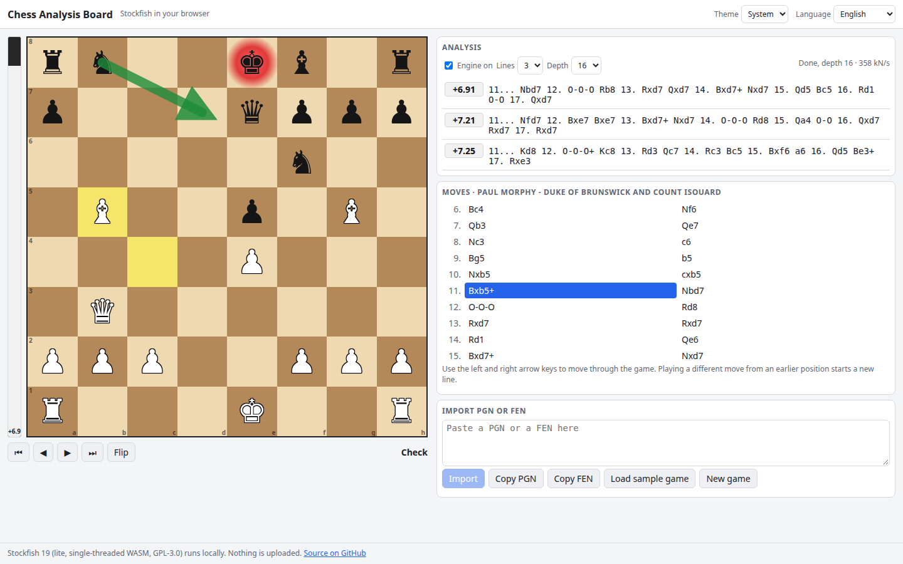

# Chess Analysis Board

A full analysis board in a static page: click to play legal moves, import a PGN or FEN, and let Stockfish (WASM, single-threaded lite build) evaluate the position live with an eval bar, several best lines and a clickable move list.

**Try it: [hermes98761234.github.io/chess-analysis-board](https://hermes98761234.github.io/chess-analysis-board/)**

[](https://github.com/hermes98761234/chess-analysis-board/actions/workflows/deploy.yml)



## Features

- **Legal-move board** powered by chess.js: highlighted targets, promotion choice, check/mate/draw detection, flip board.
- **Stockfish 19 (lite, single-threaded WASM).** Works on GitHub Pages without COOP/COEP headers. Adjustable lines (MultiPV 1-5) and depth.
- **Eval bar** and score in pawns or mate-in-N, always from White's point of view, plus the best move drawn as an arrow.
- **Best lines** with SAN principal variations; click a line to play its first move.
- **PGN / FEN import and export**, move list with navigation by click or arrow keys, and take-back by playing a different move.
- English and Ukrainian, light, dark or system theme. Settings are remembered in the browser; nothing leaves it.

## How it works

The engine runs in a Web Worker loaded from `public/engine/` (the `stockfish` npm package, lite single-threaded build, about 1.8 MB, GPL-3.0 licensed, see `public/engine/COPYING.txt`). The app speaks UCI: `position fen ...`, `setoption name MultiPV`, `go depth N`, and parses `info` lines (depth, multipv, score cp/mate, nodes, pv). A small search queue guarantees one `bestmove` per `go`, so switching positions quickly never mixes results. Scores are flipped to White's perspective and mapped to the bar with the logistic win-probability curve used by Lichess. Game logic (legal moves, PGN, FEN) is chess.js.

## Quick start

You need [Node.js](https://nodejs.org/) 22.

```bash
git clone https://github.com/hermes98761234/chess-analysis-board.git
cd chess-analysis-board
npm install
npm run dev       # http://localhost:5173
npm test          # unit tests
npm run build     # static site in dist/
```

## License

MIT

Stockfish.js (lite single-threaded build) in `public/engine/` is GPL-3.0 (see `public/engine/COPYING.txt`); the rest of the app is MIT.
